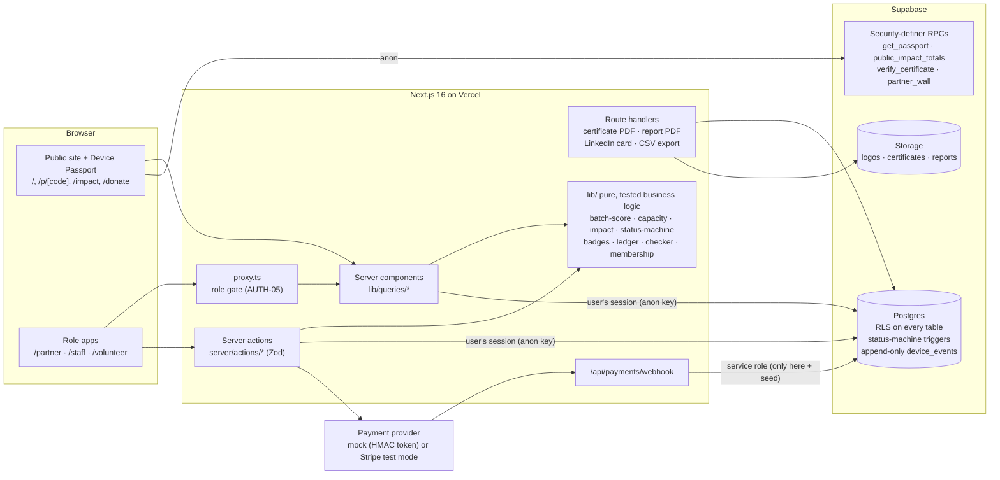

# GeekLoop

**GeekLoop makes the value Free Geek Toronto creates visible.** Businesses donate batches of retired laptops and get a data-wipe certificate plus a live impact dashboard. Every refurbished device gets a public **Device Passport** (scan the QR code). Volunteers build a **Skills Wallet** of verified hands-on work. Built for the FUSE Society Blueprint 2026 hackathon, with Free Geek Toronto (FGT) as the partner business.

- **Live demo:** _add the Vercel URL here after deploying_ → open **`/demo`** for one-click sign-in
- **Demo accounts:** `demo-partner@geekloop.test`, `demo-staff@geekloop.test`, `demo-volunteer@geekloop.test`. The shared password is shown on `/demo` in demo mode. Every organization and person in the data is fictional.
- **Payments:** test mode only. With `PAYMENT_PROVIDER=mock` (the default) nothing is charged anywhere.

---

## Guided tour (about 6 minutes)

These are flows F1–F6 from `PRD.md` §8. Start at `/demo`.

| # | Flow | Sign in as | What to do |
|---|---|---|---|
| F1 | **Partner's first donation** | Partner | **New batch** → add 20 × Dell Latitude 5420 (2021, working) → watch the Batch Value Score fill to *Excellent* → pick an open week from the capacity glasses → submit. |
| F2 | **Staff process the batch** | Staff | **Batches** (sorted by score) → open Maple Ledger's batch → approve → schedule (capacity check) → receive → bulk-add 20 devices → **QR labels** prints a 30-up sheet. |
| F3 | **Volunteer refurbishes** | Volunteer | **Claim next device** → hardware test → hold to confirm the data wipe (or press Enter twice) → install Linux Mint → final QA → a badge unlocks. |
| F4 | **Staff verify and certify** | Staff | **Devices** → select wipes pending verification → press `v` to bulk-verify → open a fully verified batch → **Issue certificate** (stamp) → download the PDF → open `/verify/GL-…` (no serials shown). |
| F5 | **Sale and passport** | Staff | Open a *Ready* device → set the price → **Record sale** (recipient: Student, optional Pay-It-Forward subsidy) → open its passport `/p/FGT-…` signed out. |
| F6 | **Partner sees impact** | Partner | Dashboard: people helped, recipient categories, CO₂e → **Impact report**: download the annual PDF, then copy the LinkedIn card and suggested post. |

Also try: `/donate` (the "Can I donate this?" checker), `/pay-it-forward` (contribute through the test checkout), `/pay-it-forward/round-up` (the round-up widget on a sample store page), **Membership** as a partner (upgrade to Champion), and **Pay-It-Forward** as staff (the fund ledger).

`DEMO_SCRIPT.md` has the exact click path for the video.

---

## Architecture



**Design choices worth knowing:**
- **Security lives in the database.** Every table has row-level security. The device status machine (PRD §9.1) is a Postgres trigger, so no code path can skip a step or reach *ready/sold* without a staff-verified wipe. `device_events` has no update or delete policy for anyone: the chain of custody is append-only.
- **The public never touches base tables.** Passports, impact totals, the Partner Wall and certificate checks go through security-definer RPCs that return only public-safe fields. Serial numbers and sanitization report IDs never leave staff and owning-partner views.
- **The service-role key is used in exactly two places:** `supabase/seed.ts` and the payment webhook. Every user action runs as that user.
- **One formula, everywhere.** Impact (kg diverted, CO₂e, volunteer hours) is computed only in `lib/impact.ts`, and the passport, partner dashboard, staff overview, public `/impact`, annual report and LinkedIn card all call it.
- **Mission guardrails are enforced in code:** Pay-It-Forward money can only be a discount for digital-inclusion recipients and the fund can't go negative (both a database guard and `lib/ledger.ts`). Partner tiers buy reporting and recognition, never priority or pricing influence.

## Tech stack

Next.js 16 (App Router, Turbopack, `proxy.ts`) · TypeScript strict · Tailwind CSS v4 · Radix primitives restyled to our clay tokens · Motion · Supabase (Postgres, Auth, Storage, RLS) via `@supabase/ssr` · Zod + React Hook Form · Recharts · `@react-pdf/renderer` · `next/og` · `qrcode` · Vitest · Playwright + axe · pnpm. The design system is "clay + liquid" (`UI_UX_DESIGN.md`); see it all on `/styleguide`.

## Run it locally

```bash
pnpm install
cp .env.example .env.local      # Supabase URL + keys, DEMO_PASSWORD, PAYMENT_PROVIDER=mock
supabase login && supabase link --project-ref <your-ref>
pnpm db:push                    # apply migrations
pnpm seed                       # fictional demo data (idempotent: safe to re-run)
pnpm dev                        # http://localhost:3000/demo
```

Stripe (optional): set `PAYMENT_PROVIDER=stripe`, `STRIPE_SECRET_KEY=sk_test_…` and `STRIPE_WEBHOOK_SECRET`. GeekLoop refuses to start a Stripe checkout with anything other than a test key and rejects live-mode webhook events.

## Tests

```bash
pnpm typecheck && pnpm lint
pnpm test                       # Vitest: every lib/ module + RLS checks against the live project
pnpm build && pnpm test:e2e     # Playwright: F1–F5, payments (mock), checker, report, axe accessibility
```

- **Unit:** batch score, capacity, impact, status machine, badges, passport codes, certificate numbers, ledger and round-ups, membership periods, payment token and Stripe signature checks, checker rules, report helpers, plus PDF and PNG render smoke tests.
- **Security (`tests/unit/rls.test.ts`):** anonymous users can't read base tables, partner A can't read partner B's batches, volunteers can't verify wipes, and events can't be updated.
- **End to end:** each flow above, unauthorized-role redirects, passport privacy (the serial number, report ID and sale price never appear in its HTML), and axe WCAG 2.1 AA scans of the public pages.

## AI-use disclosure

This project was built by our two-person team with **Claude Code** (Anthropic) as a coding assistant. We wrote the PRD, UI/UX spec and staged build plan ourselves (`PRD.md`, `UI_UX_DESIGN.md`, `KICKOFF_PROMPT.md`). Claude Code generated most of the implementation one stage at a time; we reviewed every stage, tested it in the browser, and steered the design. Impact factors and prices are placeholders marked **[ASSUMPTION] / TO VERIFY** until Free Geek Toronto confirms them.

## License

GPL-3.0, in keeping with Free Geek Toronto's open-source values. GeekLoop is a tool built *for* Free Geek Toronto; it doesn't use Free Geek's branding.
