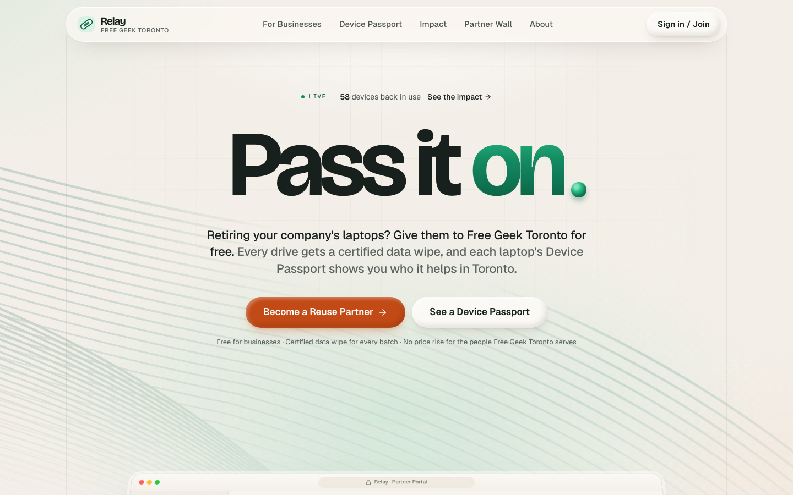
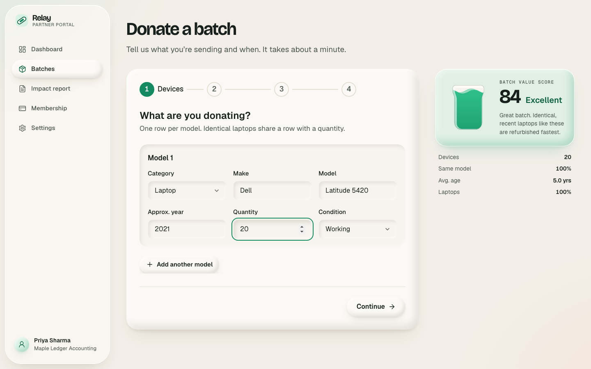
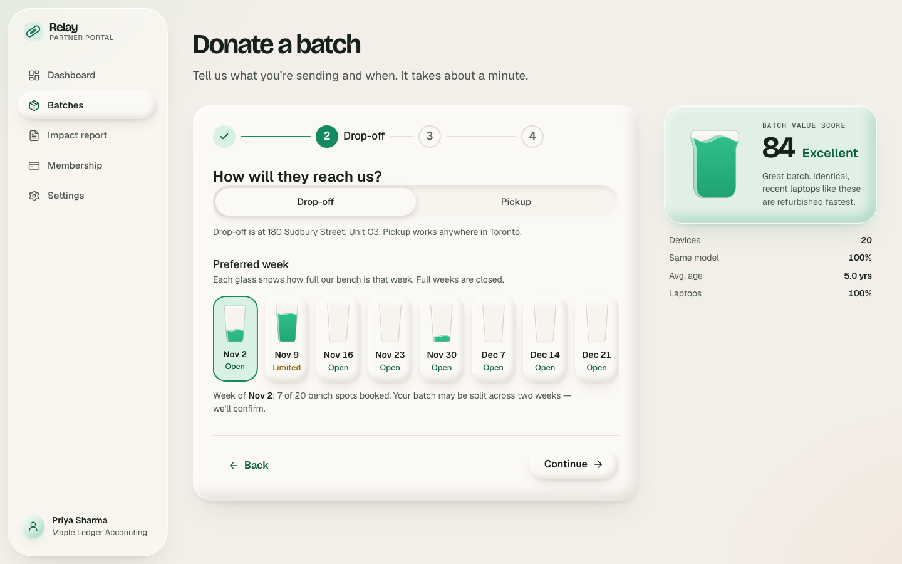
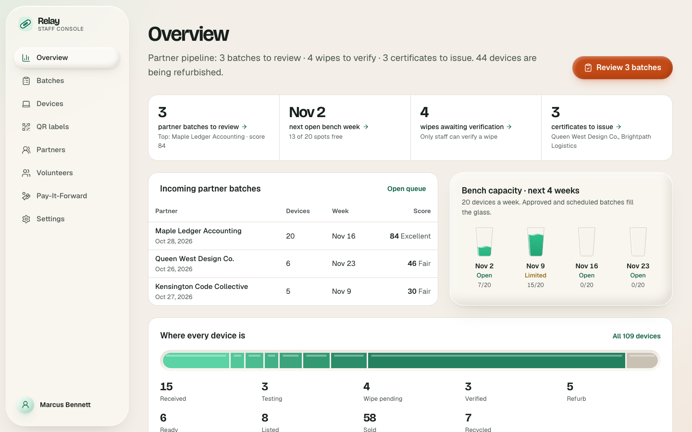
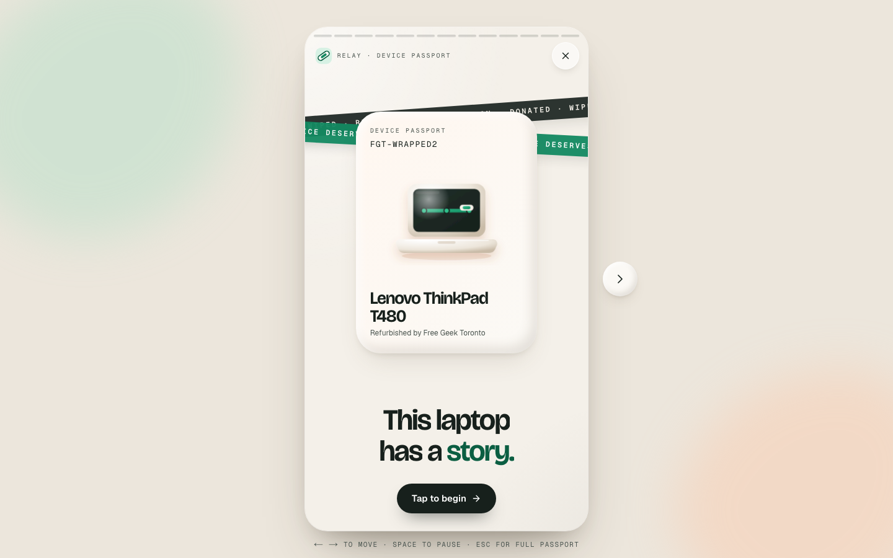
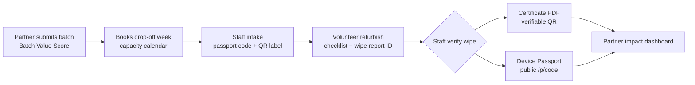

# Relay — Pass it on.

Relay gives Free Geek Toronto a steady supply of uniform laptops from Toronto businesses, with verified data wiping and a QR Device Passport that shows each laptop's second life.

[](https://freegeek-relay.vercel.app/)
[](https://nextjs.org/)
[](https://supabase.com/)
[](https://vercel.com/)
[](https://www.typescriptlang.org/)

Built for **FUSE Blueprint 2026**, Free Geek Toronto case.

## Try it

**Live app:** https://freegeek-relay.vercel.app/

Open **[/demo](https://freegeek-relay.vercel.app/demo)** and pick a role. Sign-in is one click; no password needed.

| Role | Account | Start here |
|---|---|---|
| Reuse Partner (office manager at a small business) | `demo-partner@geekloop.test` | Donate a batch, see the impact dashboard and certificates |
| Staff (Free Geek Toronto) | `demo-staff@geekloop.test` | Approve, receive and verify batches; issue certificates |
| Volunteer | `demo-volunteer@geekloop.test` | Claim a device, run the refurbish checklist, earn badges |

**Public Device Passport (no login):** [freegeek-relay.vercel.app/p/FGT-WRAPPED2](https://freegeek-relay.vercel.app/p/FGT-WRAPPED2). More examples: [FGT-QUEEN7WD](https://freegeek-relay.vercel.app/p/FGT-QUEEN7WD) (anonymous donor), [FGT-BENCH24Z](https://freegeek-relay.vercel.app/p/FGT-BENCH24Z) (still being refurbished), [FGT-PARTS4RC](https://freegeek-relay.vercel.app/p/FGT-PARTS4RC) (recycled for parts).

All organizations, people and devices are fictional demo data. Payments run through a mock checkout, so nothing is ever charged.

## Screenshots

| | |
|---|---|
|  |  |
| Landing page | Batch form with the live Batch Value Score |
|  |  |
| Drop-off capacity calendar | Staff Console |
|  | |
| Public Device Passport | |

## The problem

Device sales are about 77% of Free Geek Toronto's revenue, but the laptops worth the most to them (recent, working, many of the same model) rarely reach them. Businesses retiring 10–50 laptops go to trade-in programs, resellers or paid IT disposal instead, because nothing gives them proof of data destruction or a visible result. FGT has zero corporate partners and no partner program.

## The solution: one change

Relay introduces the **Reuse Partnership**, a free program that turns a business's retired laptops into a tracked, certified **batch**:

1. **Partner submits a batch.** A live **Batch Value Score** (uniformity, age, volume, laptop share) shows how valuable it is.
2. **Partner books a drop-off week** on a capacity calendar, so FGT never gets more than it can handle.
3. **Staff intake.** One step receives the batch and creates every device, each with a passport code and a printable QR label (30-up sheet).
4. **Volunteer refurbishes** with a checklist: hardware test, data wipe (records the sanitization report ID), OS install, final QA.
5. **Staff verify the wipe.** Only staff can mark a wipe verified, after checking the recorded report ID against FGT's sanitization software. The database won't let a device be sold without it.
6. **Certificate PDF** for the batch, numbered, with a QR code and a public verification page (no serial numbers shown).
7. **Device Passport.** Scanning the QR shows the laptop's story: who donated it (if they opted in), its certified data wipe, the volunteer who rebuilt it, and who it went to.
8. **Partner impact dashboard:** people helped, kg diverted, CO2e, every laptop's passport, an annual PDF report and a LinkedIn share card.

**Also included (working, quieter):**
- **Pay-It-Forward fund:** contributions and a checkout round-up that lower prices for digital-inclusion buyers; the fund can't go negative.
- **"Can I donate this?" checker** for households, which routes businesses with 5+ devices to the Reuse Partnership.
- **Volunteer Skills Wallet:** 7 verifiable badges (First Boot, Diagnostician, Data Guardian, Open Source Installer, Bench Regular, Century Club, Mentor) and a public profile.
- **Partner tiers:** Community is free and includes the full pipeline; Impact ($500/yr) and Champion ($1,500/yr) add reporting and recognition only, never priority. Prices are placeholders until FGT confirms them.
- **Public impact page and Partner Wall.**

## Tech stack

| Layer | Tool |
|---|---|
| Framework | Next.js 16 (App Router, Turbopack, `proxy.ts`) + TypeScript (strict) |
| Database, auth, files | Supabase: Postgres, Auth, Storage, row-level security (`@supabase/ssr`) |
| UI | Tailwind CSS v4, shadcn/ui on Radix primitives, lucide-react |
| Motion | Motion |
| Forms and validation | Zod, React Hook Form |
| Charts | Recharts |
| PDFs and QR codes | @react-pdf/renderer, qrcode |
| Tests | Vitest, Playwright, axe-core |
| Hosting | Vercel |

## Architecture and security

**Roles:** `partner`, `staff`, `volunteer`, and the anonymous public. `proxy.ts` gates each role app (`/partner`, `/staff`, `/volunteer`); the database enforces the rules underneath.

- **Row-level security on every table.** A partner sees only their own organization's batches and devices; volunteers see only the bench.
- **Append-only device history.** `device_events` has no update or delete policy for anyone, so the chain of custody can't be rewritten.
- **Staff-only wipe verification.** The device status machine is a Postgres trigger: no code path can skip a step or reach *ready* or *sold* without a staff-verified wipe.
- **The public never touches base tables.** Passports, certificate checks and impact totals go through security-definer functions that return only public-safe fields. Serial numbers and report IDs never appear publicly.
- **The service-role key is used in only two places:** the seed script and the payment webhook. Everything else runs as the signed-in user.
- **Every server action is validated with Zod.** Business formulas (score, capacity, impact, badges) live once in `lib/` with unit tests.



## Run locally

**Prerequisites:** Node.js 20+, pnpm 10 (`corepack enable`), a Supabase project, and the [Supabase CLI](https://supabase.com/docs/guides/cli).

```bash
git clone https://github.com/K4RM-P/Relay.git
cd Relay
pnpm install
cp .env.example .env.local        # fill in your Supabase URL and keys
supabase login
supabase link --project-ref <your-project-ref>
pnpm db:push                      # apply the migrations in supabase/migrations
pnpm seed                         # load fictional demo data (resets demo rows; safe to re-run)
pnpm dev                          # http://localhost:3000/demo
```

The repo uses pnpm (pinned in `package.json`). Payments default to `PAYMENT_PROVIDER=mock`, so no Stripe keys are needed.

## Tests

```bash
pnpm typecheck && pnpm lint
pnpm test                         # Vitest unit tests
pnpm build && pnpm test:e2e       # Playwright end-to-end tests (runs against pnpm start)
```

- **Unit (Vitest), 110 tests in 17 files, all passing:** Batch Value Score, capacity, impact, the status machine, badges, passport codes, certificate numbers, the Pay-It-Forward ledger, membership, payment token checks, the donation checker, report helpers, PDF/PNG render smoke tests, and RLS checks against the live database (anonymous users can't read base tables, partner A can't read partner B, volunteers can't verify wipes, events can't be updated).
- **End to end (Playwright):** 57 tests; last local run: 52 passed, 5 failed (F2 staff intake, F3 volunteer checklist, and three mock-checkout payment tests), being fixed. Covers the partner, staff, volunteer, certificate and passport flows, role redirects, passport privacy (no serials, report IDs or prices in the HTML), payments in mock mode, the checker, the report, and axe WCAG 2.1 AA scans of the public pages.

## Project structure

```
app/
  (public)/        landing, become-a-partner, /p/[code] passport, /verify, /impact, /donate, /demo
  partner/         Reuse Partner portal
  staff/           Staff Console
  volunteer/       Volunteer Bench and Skills Wallet
components/        design system (clay, liquid, illustrations) and restyled shadcn/ui
lib/               pure, tested business logic (batch-score, capacity, impact, status-machine, ...)
server/actions/    Zod-validated server actions
supabase/
  migrations/      schema, RLS, triggers, RPCs
  seed.ts          fictional demo data
tests/unit, tests/e2e
```

## Cost to run

About $50 to launch, then about CAD $80/month on paid hosting tiers (Vercel and Supabase).

## Team

**Karm Patel** and **Debashish Panchal**. Built for FUSE Blueprint 2026, Free Geek Toronto case.

## AI disclosure

Built with the help of Claude Code (Anthropic).

## License

[GPL-3.0](LICENSE). Copyright 2026 Karm Patel and Debashish Panchal. Relay is built *for* Free Geek Toronto and doesn't use Free Geek's branding.
