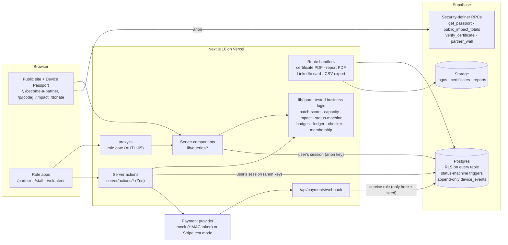

# Relay

**Relay turns Toronto small businesses into a recurring source of uniform laptops for Free Geek Toronto.**

Built for the FUSE Society Blueprint 2026 hackathon, with Free Geek Toronto (FGT) as the partner business.
Every screen in Relay serves that one change.

**Why it matters.** FGT's supply of high-value, uniform laptops is shrinking and it has no corporate
partners, while device sales are about 77% of its revenue. A business retiring a fleet has no reason to
pick FGT over a trade-in, a reseller or paid IT disposal. Relay gives it three: a **free, certified data
wipe** documented on a certificate, **zero hassle** (a two-minute sign-up and batch form), and **visible
proof** that its laptops helped real people in Toronto: a Device Passport for every laptop. Relay
*introduces* the **Reuse Partnership**; FGT doesn't run a partner or membership program today.

**Who it's for.** The office manager or IT lead at a Toronto small or medium business retiring a fleet of laptops.

## The core loop

```
Business signs up and submits a batch → staff intake → volunteers refurbish
→ certified data wipe (staff verify every one) → certificate → Device Passport (the partner's proof of impact)
```

1. **Reuse Partner pipeline.** Become a Reuse Partner (free) → submit a **batch** in three steps, with a live
   **Batch Value Score** and a capacity-aware calendar → staff approve, schedule and receive it → every drive
   gets a **certified data wipe** (a volunteer records it with the reference ID from FGT's sanitization
   software; only staff can verify it) → the business downloads a numbered certificate that documents the
   process for each device, with a public verification page.
2. **Device Passport.** Every laptop gets a QR label. Its passport tells its story: the donating business (if
   it opted in), its certified data wipe, the volunteer who rebuilt it (if they opted in), its impact and
   where the buyer's money goes. The business sees every one of its laptops on its dashboard ("Your laptops":
   stage, "now helping a student", total passport views), and its own laptops' passports open with
   "This was one of your laptops" and end with a thank-you.

**Supporting:** the **Staff Console** and the **Volunteer Bench** are how FGT's small team handles the volume:
bulk intake with pasted or scanned serials, set mode for identical laptops, whole-batch wipe verification,
and Reuse Partnership metrics. See `audit/FRICTION.md`: about 83% fewer interactions per device.

**Included but quiet:** Pay-It-Forward fund, the "Can I donate this?" household checker, Skills Wallet
badges, and optional paid memberships (the free Community tier *is* the program; paid tiers are optional
extras, never the main value). They live in the footer and a small "More ways to help" area.

- **Live demo:** _add the Vercel URL here after deploying_ → open **`/demo`**
- **Demo accounts:** `demo-partner@geekloop.test`, `demo-staff@geekloop.test`, `demo-volunteer@geekloop.test`. The shared password is shown on `/demo` in demo mode. Every organization, person and number in the demo data is fictional.
- **Payments:** test mode only. With `PAYMENT_PROVIDER=mock` (the default) nothing is charged anywhere.

## How to explore (about 5 minutes)

1. Open **`/demo`**. (Shared demo? Press **Reset demo** first: it puts fresh work in every queue. The four showcase passports never change.)
2. **Partner** → **Donate a batch** → 20 × Dell Latitude 5420, 2021 → watch the Batch Value Score reach *Excellent* → Continue (drop-off and the next open week are preselected) → tick the drives-intact box → **Submit**.
3. **Staff** → Overview → **Batches** → open the batch → **Approve & schedule** → **Receive & add 20 devices** → paste serials → **QR labels**.
4. **Volunteer** → **Claim 5 at once** → **Work on all … together** → hardware test, wipe references (paste or scan), OS, final QA for the whole set.
5. **Staff** → the batch → **Verify N wipes** → **Issue certificate** on a fully verified batch → open the PDF and `/verify/GL-…`.
6. **Partner** → **Your laptops** → open a Device Passport (`FGT-WRAPPED2` is a sold one) to see the personalized story. Open it signed out to see the public version.

`DEMO_SCRIPT.md` is the exact click path for the video. `HOW_IT_WORKS.md` explains the permission model,
status machine, certificates, passport privacy and the scoring. `ADMIN_GUIDE.md` is the guide for FGT staff.

---

## Architecture



**Design choices worth knowing:**
- **Security lives in the database.** Every table has row-level security. The device status machine (PRD §9.1) is a Postgres trigger, so no code path can skip a step or reach *ready/sold* without a staff-verified wipe. `device_events` has no update or delete policy for anyone: the chain of custody is append-only.
- **The public never touches base tables.** Passports, impact totals, the Partner Wall and certificate checks go through security-definer RPCs that return only public-safe fields. Serial numbers and sanitization report IDs never leave staff and owning-partner views.
- **The service-role key is used in exactly two places:** `supabase/seed.ts` and the payment webhook. Every user action runs as that user.
- **One formula, everywhere.** Impact (kg diverted, CO₂e, volunteer hours) is computed only in `lib/impact.ts`, and the passport, partner dashboard, staff overview, public `/impact`, annual report and LinkedIn card all call it.
- **Mission guardrails are enforced in code:** Pay-It-Forward money can only be a discount for digital-inclusion recipients and the fund can't go negative (both a database guard and `lib/ledger.ts`). Partner tiers buy reporting and recognition, never priority or pricing influence.

## Tech stack

Next.js 16 (App Router, Turbopack, `proxy.ts`) · TypeScript strict · Tailwind CSS v4 · Radix primitives restyled to our clay tokens · Motion · Supabase (Postgres, Auth, Storage, RLS) via `@supabase/ssr` · Zod + React Hook Form · Recharts · `@react-pdf/renderer` · `next/og` · `qrcode` · Vitest · Playwright + axe · pnpm. The design system is "clay + liquid" (`UI_UX_DESIGN.md`); see it all on `/styleguide`.

## Run it locally

```bash
pnpm install
cp .env.example .env.local      # Supabase URL + keys, DEMO_PASSWORD, PAYMENT_PROVIDER=mock
supabase login && supabase link --project-ref <your-ref>
pnpm db:push                    # apply migrations (includes 20261027000001_alignment.sql)
pnpm seed                       # fictional demo data (idempotent: safe to re-run)
pnpm dev                        # http://localhost:3000/demo
```

Production check: `pnpm build && pnpm start`. Stripe (optional): set `PAYMENT_PROVIDER=stripe`, `STRIPE_SECRET_KEY=sk_test_…` and `STRIPE_WEBHOOK_SECRET`. Relay refuses anything other than a test key and rejects live-mode webhook events.

## Tests

```bash
pnpm typecheck && pnpm lint
pnpm test                       # Vitest: every lib/ module, certificate contents, RLS checks against the live project
pnpm build && pnpm test:e2e     # Playwright against the production build
```

- **Unit:** batch score, capacity, impact, status machine, badges, passport codes, certificate numbers and wording, certificate PDF contents, bulk entry (paste/scan), program metrics, passport story and personalization, ledger, membership, payments, checker, report.
- **Security (`tests/unit/rls.test.ts`):** anonymous users can't read base tables, partner A can't read partner B's batches, volunteers can't verify wipes, events can't be updated.
- **End to end:** the new-partner journey (step count and under 2 minutes), flows F1–F5, volunteer set mode, privacy and consent (every opt-in, personalized passport only for its owner, no private fields on public or partner pages), two sessions at once plus Reset demo, invalid input on every core form, payments (mock), checker, report, and axe WCAG 2.1 AA scans.

## AI-use disclosure

This project was built by our two-person team with **Claude Code** (Anthropic) as a coding assistant. We wrote the PRD, UI/UX spec and staged build plan ourselves (`PRD.md`, `UI_UX_DESIGN.md`, `KICKOFF_PROMPT.md`). Claude Code generated most of the implementation one stage at a time; we reviewed every stage, tested it in the browser, and steered the design. Impact factors and prices are placeholders marked **[ASSUMPTION] / TO VERIFY** until Free Geek Toronto confirms them.

## License

GPL-3.0, in keeping with Free Geek Toronto's open-source values. Relay is a tool built *for* Free Geek Toronto; it doesn't use Free Geek's branding.
