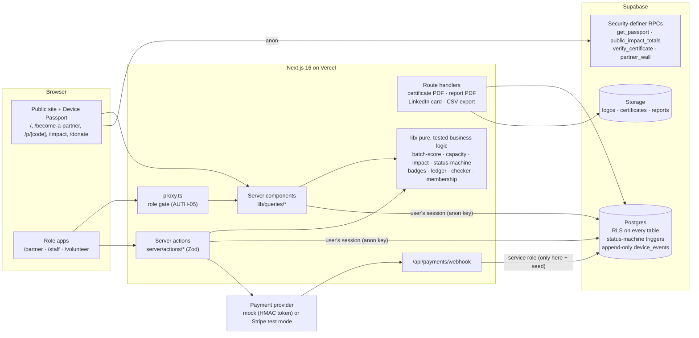

# Relay

**Relay gives Toronto small businesses free, certified data destruction and a visible record of who their retired laptops help, turning them into a steady supply of uniform laptops for Free Geek Toronto, without raising prices for the communities it serves.** Built for the FUSE Society Blueprint 2026 hackathon, with Free Geek Toronto (FGT) as the partner business.

**The problem.** FGT's supply of high-value, uniform laptops is shrinking and it has zero corporate partners, while device sales are about 77% of its revenue. Businesses have no reason to choose FGT over trade-in programs, resellers or paid IT disposal: no proof of data destruction, no visible impact, no recognition. Relay introduces a **Reuse Partnership** to fix that (FGT has no partner or membership program today).

**Who it's for.** The office manager or IT lead at a Toronto small or medium business retiring 10–50 laptops.

- **Live demo:** _add the Vercel URL here after deploying_ → open **`/demo`** for one-click sign-in
- **Demo accounts:** `demo-partner@geekloop.test`, `demo-staff@geekloop.test`, `demo-volunteer@geekloop.test`. The shared password is shown on `/demo` in demo mode. Every organization and person in the data is fictional.
- **Payments:** test mode only. With `PAYMENT_PROVIDER=mock` (the default) nothing is charged anywhere.

---

## What Relay does

### Core
1. **The Reuse Partner pipeline (the engine).** Become a Reuse Partner (free) → submit a **batch** with a live **Batch Value Score** and a capacity-aware calendar → staff approve, schedule and receive it → every drive gets a **certified data wipe** (a volunteer wipes, only staff can verify) → the partner downloads a numbered certificate with a public verification link.
2. **The QR Device Passport ("Relay Wrapped").** Every device gets a QR label. Scanning it opens the device's story: donated by which Reuse Partner (if they opted in), its certified data wipe, the volunteer who rebuilt it, its impact, and where the buyer's money goes. This is what makes the impact visible to buyers and partners.

### Supporting (how the core works)
3. **Partner impact dashboard and certificates:** why partners stay. People helped, recipient categories, every device linked to its Device Passport, an annual report and a LinkedIn card.
4. **Volunteer Bench and Skills Wallet:** how FGT handles the extra volume. Volunteers claim the best-scoring partner devices first, their work is stamped on each Device Passport, and they earn verifiable skill badges.
5. **Staff Console:** how a tiny team runs it all in minutes. The overview leads with incoming partner batches, capacity, wipes awaiting verification and certificates to issue.

### Also included (fully working, quieter)
6. **Pay-It-Forward fund:** optional contributions that lower prices for digital-inclusion buyers.
7. **"Can I donate this?" household checker:** triages household donations and routes businesses with 5+ devices to the Reuse Partnership.
8. **Paid membership tiers:** the free **Community** tier is the headline and includes everything above. Impact ($500) and Champion ($1,500) are optional extras for businesses that want more reporting and recognition. The main value to FGT is more and better laptops, not fees. Fees are memberships, not donations, and come with no tax receipt. Prices are [ASSUMPTION] until FGT confirms them.

---

## Guided tour (about 6 minutes)

These are flows F1–F6 from `PRD.md` §8. Start at `/demo`: Partner first, then a showcase Device Passport, then Staff and Volunteer.

| # | Flow | Sign in as | What to do |
|---|---|---|---|
| F1 | **Partner's first donation** | Partner | **Donate a batch** → add 20 × Dell Latitude 5420 (2021, working) → watch the Batch Value Score fill to *Excellent* → pick an open week from the capacity glasses → submit. |
| F2 | **Staff process the batch** | Staff | Overview: the partner pipeline tiles → **Batches** (sorted by score) → open Maple Ledger's batch → approve → schedule (capacity check) → receive → bulk-add 20 devices → **QR labels** prints a 30-up sheet. |
| F3 | **Volunteer refurbishes** | Volunteer | **Claim next device** (it says which kind of batch it came from) → hardware test → hold to confirm the data wipe (or press Enter twice) → install Linux Mint → final QA → a badge unlocks. |
| F4 | **Staff verify and certify** | Staff | **Devices** → select wipes pending verification → press `v` to bulk-verify → open a fully verified batch → **Issue certificate** (stamp) → download the PDF → open `/verify/GL-…` (no serials shown). |
| F5 | **Sale and Device Passport** | Staff | Open a *Ready* device → set the price → **Record sale** (recipient: Student, optional Pay-It-Forward subsidy) → open its Device Passport `/p/FGT-…` signed out. |
| F6 | **Partner sees impact** | Partner | Dashboard: people helped, certificates, every laptop's Device Passport → **Impact report**: download the annual PDF, then copy the LinkedIn card and suggested post. |

Also included: `/pay-it-forward` (contribute through the test checkout), `/pay-it-forward/round-up` (the round-up widget on a sample store page), `/donate` (the "Can I donate this?" checker), **Membership** as a partner (optional upgrade to Champion), and **Pay-It-Forward** as staff (the fund ledger). On the public site these live in the footer and the landing page's "More ways to help".

`DEMO_SCRIPT.md` has the exact click path for the video.

---

## Architecture



**Design choices worth knowing:**
- **Security lives in the database.** Every table has row-level security. The device status machine (PRD §9.1) is a Postgres trigger, so no code path can skip a step or reach *ready/sold* without a staff-verified wipe. `device_events` has no update or delete policy for anyone: the chain of custody is append-only.
- **The public never touches base tables.** Passports, impact totals, the Partner Wall and certificate checks go through security-definer RPCs that return only public-safe fields. Serial numbers and sanitization report IDs never leave staff and owning-partner views.
- **The service-role key is used in exactly two places:** `supabase/seed.ts` and the payment webhook. Every user action runs as that user.
- **One formula, everywhere.** Impact (kg diverted, CO₂e, volunteer hours) is computed only in `lib/impact.ts`, and the passport, partner dashboard, staff overview, public `/impact`, annual report and LinkedIn card all call it.
- **Mission guardrails are enforced in code:** Pay-It-Forward money can only be a discount for digital-inclusion recipients and the fund can't go negative (both a database guard and `lib/ledger.ts`). Partner tiers buy reporting and recognition, never priority or pricing influence.

## Tech stack

Next.js 16 (App Router, Turbopack, `proxy.ts`) · TypeScript strict · Tailwind CSS v4 · Radix primitives restyled to our clay tokens · Motion · Supabase (Postgres, Auth, Storage, RLS) via `@supabase/ssr` · Zod + React Hook Form · Recharts · `@react-pdf/renderer` · `next/og` · `qrcode` · Vitest · Playwright + axe · pnpm. The design system is "clay + liquid" (`UI_UX_DESIGN.md`); see it all on `/styleguide`.

## Run it locally

```bash
pnpm install
cp .env.example .env.local      # Supabase URL + keys, DEMO_PASSWORD, PAYMENT_PROVIDER=mock
supabase login && supabase link --project-ref <your-ref>
pnpm db:push                    # apply migrations
pnpm seed                       # fictional demo data (idempotent: safe to re-run)
pnpm dev                        # http://localhost:3000/demo
```

Stripe (optional): set `PAYMENT_PROVIDER=stripe`, `STRIPE_SECRET_KEY=sk_test_…` and `STRIPE_WEBHOOK_SECRET`. Relay refuses to start a Stripe checkout with anything other than a test key and rejects live-mode webhook events.

## Tests

```bash
pnpm typecheck && pnpm lint
pnpm test                       # Vitest: every lib/ module + RLS checks against the live project
pnpm build && pnpm test:e2e     # Playwright: F1–F5, payments (mock), checker, report, axe accessibility
```

- **Unit:** batch score, capacity, impact, status machine, badges, passport codes, certificate numbers, ledger and round-ups, membership periods, payment token and Stripe signature checks, checker rules, report helpers, plus PDF and PNG render smoke tests.
- **Security (`tests/unit/rls.test.ts`):** anonymous users can't read base tables, partner A can't read partner B's batches, volunteers can't verify wipes, and events can't be updated.
- **End to end:** each flow above, unauthorized-role redirects, passport privacy (the serial number, report ID and sale price never appear in its HTML), and axe WCAG 2.1 AA scans of the public pages.

## AI-use disclosure

This project was built by our two-person team with **Claude Code** (Anthropic) as a coding assistant. We wrote the PRD, UI/UX spec and staged build plan ourselves (`PRD.md`, `UI_UX_DESIGN.md`, `KICKOFF_PROMPT.md`). Claude Code generated most of the implementation one stage at a time; we reviewed every stage, tested it in the browser, and steered the design. Impact factors and prices are placeholders marked **[ASSUMPTION] / TO VERIFY** until Free Geek Toronto confirms them.

## License

GPL-3.0, in keeping with Free Geek Toronto's open-source values. Relay is a tool built *for* Free Geek Toronto; it doesn't use Free Geek's branding.
